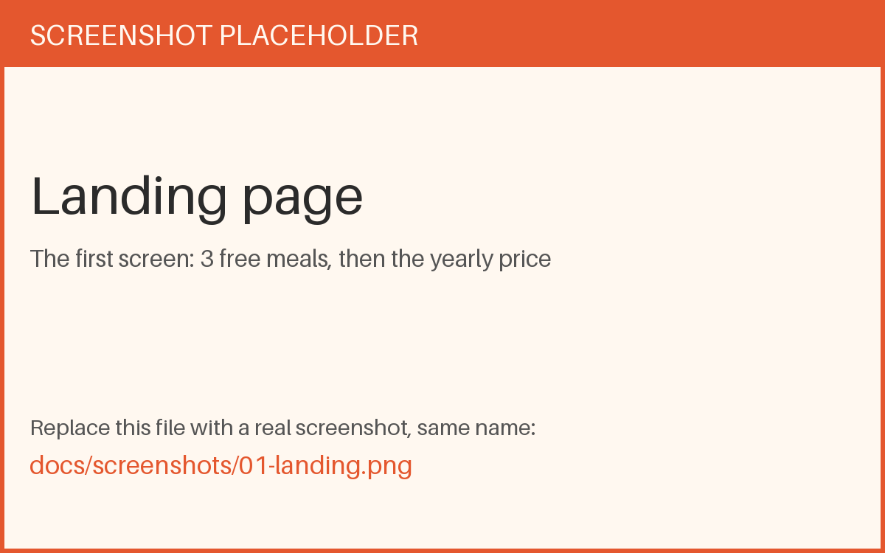
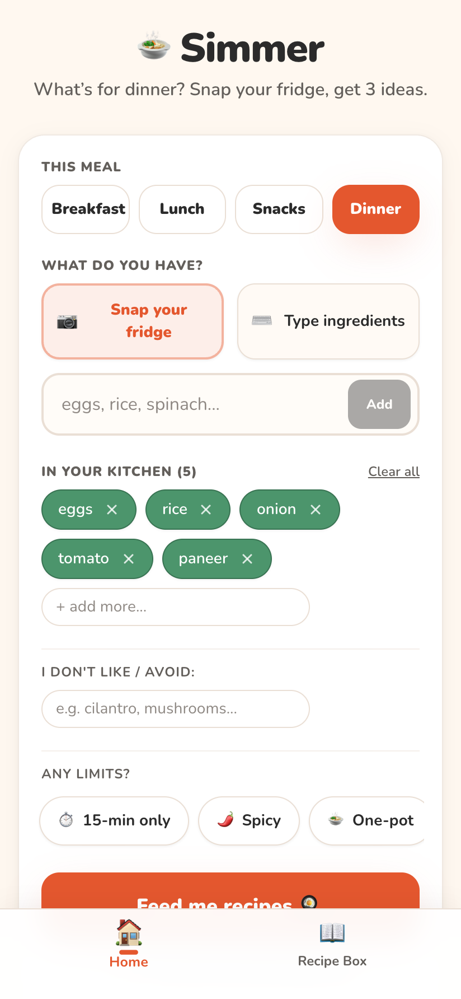
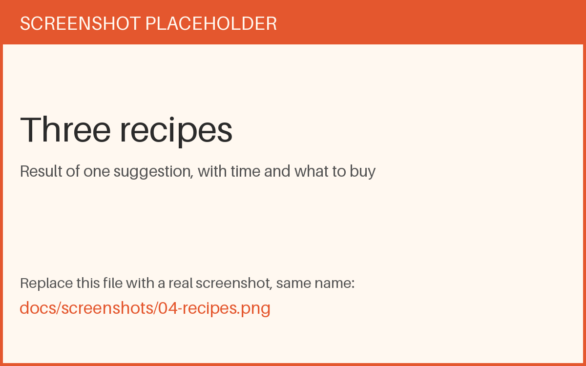
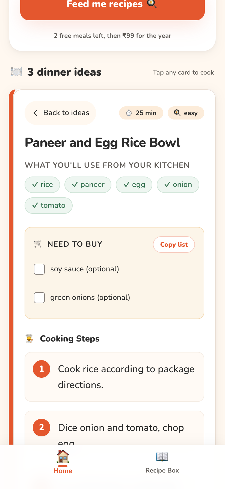
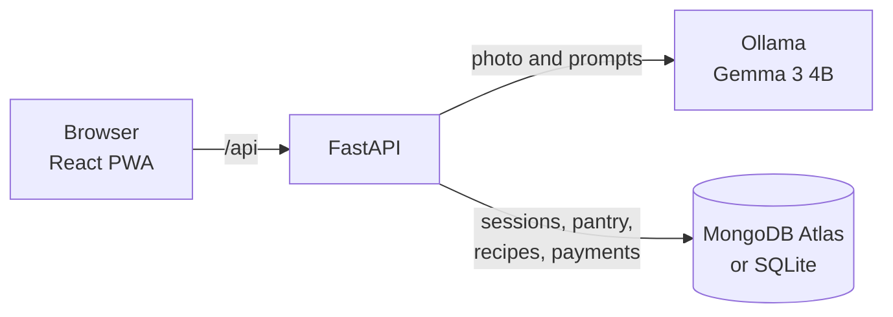

# Simmer

**Snap your fridge. Get three recipes you can cook right now.**

My flatmate asks the same question almost every day: *what should we eat?* Simmer answers it. Take a photo of your fridge or type what you have, pick breakfast, lunch, a snack, or dinner, and get exactly three recipes. Each one has short steps and a "need to buy" list, ranked by how little extra shopping it needs.

It runs on **Gemma 3 4B** through [Ollama](https://ollama.com), on your own machine. Fridge photos never go to a paid AI API, which is why the price can stay small:

> **Try 3 meals free. Then ₹99 for the year.**

| | | | |
|---|---|---|---|
|  |  |  |  |
| **Landing.** Free meals first. | **Kitchen.** Pick a meal, add what you have. | **Three ideas.** Fewest items to buy first. | **Shopping list.** Copy what is missing. |

## What it does

- **Fridge photo or typing.** Use the camera, pick a photo from your library, or type ingredients.
- **Four meals.** The clock picks breakfast, lunch, snacks, or dinner, and you can change it.
- **Your limits.** 15 minutes, spicy, one-pot, vegetarian, and ingredients you dislike.
- **Home-kitchen recipes.** Rice, dal, eggs, onion, roti, leftovers. No truffle oil unless you already have it.
- **Recipe box.** Save meals, or pull a recipe out of a screenshot of a social post.
- **No account.** Your pantry is remembered, and the app installs on a phone like a normal app.

## How it works



1. **One model does everything.** Gemma reads the fridge photo and writes the recipes.
2. **Photos are checked first.** Gemma describes what is in the picture before listing anything. A chat screenshot or a document is turned away instead of becoming a made-up grocery list.
3. **Three recipes as JSON.** Your ingredients, the meal, and your limits go into one prompt. You confirm the ingredient list before cooking.
4. **Free meals are counted on the server.** Only successful suggestions count.

| Layer | Choice |
|---|---|
| Model | Gemma 3 4B through Ollama (text and vision) |
| API | FastAPI |
| Data | MongoDB Atlas, or a local SQLite file |
| UI | React, Vite, Tailwind CSS, installable PWA |

## Quick start

You need Python 3.10+, Node.js 18+, [Ollama](https://ollama.com/download), and a computer with at least 8 GB of memory.

**1. Get the model** (about 3.3 GB):

```bash
ollama pull gemma3:4b
```

Ollama usually starts by itself. If `curl http://localhost:11434/api/tags` answers, it is running.

**2. Start the API:**

```bash
cd backend
python -m venv .venv
source .venv/bin/activate        # Windows: .venv\Scripts\activate
pip install -r requirements.txt
cp .env.example .env
python main.py
```

**3. Start the web app** in a second terminal:

```bash
cd frontend
npm install
npm run dev
```

Open **http://localhost:5173**. Keep both terminals running.

**4. Check it:** http://localhost:8000/api/health should show `"ollama": true`.

A local model takes its time. On an 8 GB MacBook Air, one suggestion takes about a minute and a photo takes 10 to 30 seconds.

## Configuration

Settings live in `backend/.env`, copied from `backend/.env.example`. This file is ignored by git, so keep your secrets there.

| Variable | Purpose |
|---|---|
| `DB_BACKEND` | `sqlite` for a local file (default), `mongo` for MongoDB Atlas |
| `MONGO_URI` | Atlas connection string, ending in `/simmer` |
| `OLLAMA_MODEL` | The model to use. Default `gemma3:4b` |
| `OLLAMA_TIMEOUT` | Seconds to wait for one answer. Default `240` |
| `SIMMER_UPI_ID` | Your UPI ID for the yearly QR |
| `ADMIN_PASSWORD` | Password for the `/admin` page |
| `SMTP_HOST`, `SMTP_USER`, `SMTP_PASSWORD`, `SMTP_FROM` | Mail account that sends PDF receipts |

`.env.example` lists every option with a default.

**MongoDB Atlas:**

1. Create a free M0 cluster and a database user.
2. Under **Network Access**, allow your IP address.
3. Under **Connect**, then **Drivers**, then **Python**, copy the connection string into `MONGO_URI`, and set `DB_BACKEND=mongo`.

If Atlas can't be reached, the API falls back to SQLite and keeps running. `/api/health` shows which one is active.

## Free meals and payments

Every visitor gets three free suggestions. On the fourth, Simmer offers a year for ₹99:

1. The visitor scans the UPI QR and pays.
2. They paste the UTR from their UPI app and their email.
3. You open **http://localhost:5173/admin**, find that UTR in your own UPI app, and switch the claim to **Paid**.
4. Their kitchen unlocks for a year, and Simmer emails them a **PDF receipt**.

Nothing unlocks until you confirm the money arrived. For Gmail receipts, use an [App Password](https://myaccount.google.com/apppasswords), not your normal password.

## Install on a phone

- **Android, Chrome:** menu, then **Install app**.
- **iPhone, Safari:** Share, then **Add to Home Screen**.

The site must be on **HTTPS** for a phone to install it or use the camera. `localhost` on your own computer is the only exception.

## Project structure

```text
backend/
  main.py        Routes, sessions, free meals, payments, admin
  ai_client.py   Ollama client for text and photos
  prompts.py     Prompts, including meal guidance
  storage.py     MongoDB, SQLite, and in-memory storage
  receipts.py    PDF receipt and email
frontend/
  src/
    components/  Landing, kitchen, camera, recipes, recipe box, offer, admin
    utils/       API client and meal helpers
  public/        Manifest, service worker, icons
```

<details>
<summary><strong>API reference</strong></summary>

| Method | Path | Purpose |
|---|---|---|
| `GET` | `/api/health` | API, database, and Ollama status |
| `GET` | `/api/session` | Load or create the visitor's kitchen |
| `POST` | `/api/session/enter` | Remember that the kitchen was opened |
| `POST` | `/api/ingredients-from-photo` | Ingredients from a photo, or a refusal if it isn't food |
| `POST` | `/api/suggest` | Three recipes. Returns `402` after the free meals |
| `POST` | `/api/save-from-screenshot` | Save a recipe from a screenshot |
| `GET` / `POST` | `/api/pantry` | Read or save ingredients and dislikes |
| `GET` / `POST` | `/api/recipe-box` | List or save recipes |
| `DELETE` | `/api/recipe-box/{id}` | Remove a recipe |
| `GET` | `/api/payment/info` | Price, UPI ID, and QR |
| `POST` | `/api/payment/claim` | Submit a UTR and email |
| `POST` | `/api/admin/login` | Admin sign-in |
| `GET` | `/api/admin/claims` | List payment claims |
| `POST` | `/api/admin/claims/{id}/toggle` | Mark a claim paid or pending |

Interactive docs: http://localhost:8000/docs

</details>

<details>
<summary><strong>Troubleshooting</strong></summary>

| Problem | Fix |
|---|---|
| `python main.py` says `Address already in use` | An old API is still running. Run `lsof -ti tcp:8000 \| xargs kill` and start again. |
| `ollama serve` says `address already in use` | Ollama is already running. Leave it. |
| Health shows `sqlite` instead of `mongo` | Your IP isn't allowed in Atlas Network Access. Home IPs change, so add the new one and restart. |
| `/admin` doesn't load | Start the web app with `npm run dev`. |
| Suggestion returns `504` | The model ran past `OLLAMA_TIMEOUT`. Close heavy apps to free memory. |
| No camera prompt | The camera needs HTTPS or `localhost`. Check the browser's site settings. |
| Blank page after an update | Reload twice, or clear site data in DevTools. |
| `code for hash blake2b was not found` | A harmless warning from some Python builds. |

</details>

## Known limits

- **Photo reading is a guess.** A 4B model can miss a jar or name one wrong, so you always confirm the list.
- **Payments are checked by hand.** There is no payment gateway. You confirm each UTR yourself.
- **Paid access stays on one device.** Restoring it on a new phone by email isn't built yet.
- **Free meals reset with a new browser.** A private window gets three new free meals. Paid access can't be faked that way.

## Privacy

There are no accounts. Photos go only to the model you run, and Simmer doesn't store them. The database keeps a random session id, your pantry, saved recipes, and suggestion history. If you pay, it also keeps your email and UTR, so the payment can be checked and the receipt sent.

## License

[MIT](LICENSE) © 2026 Himanshu Nikam
