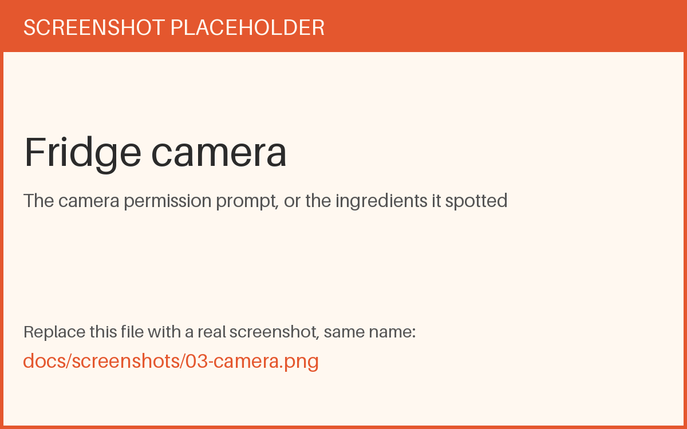
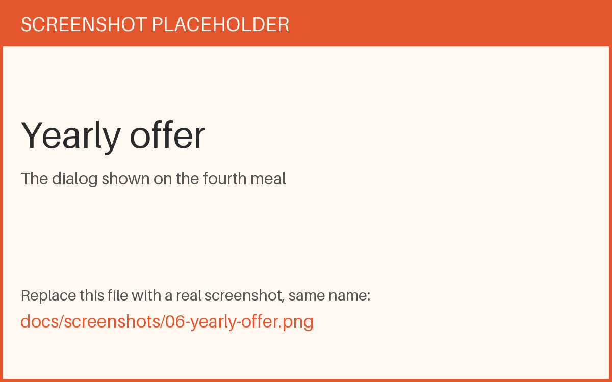
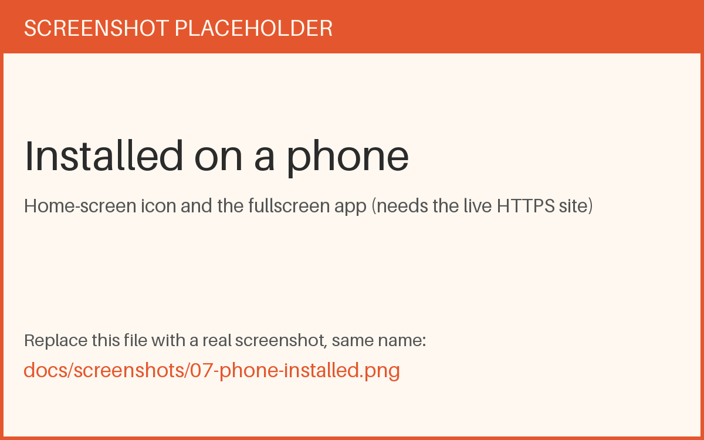
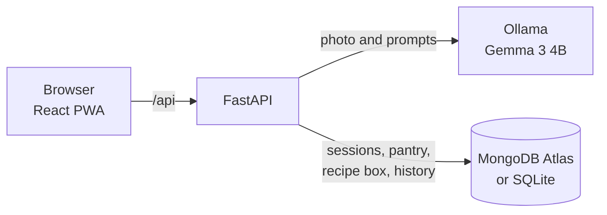
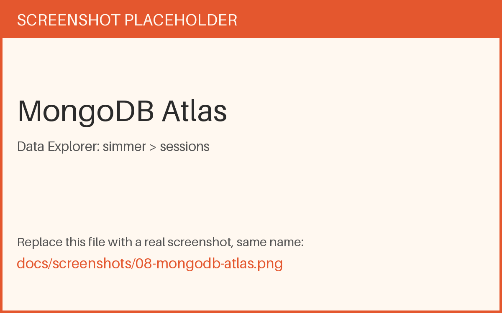

# Simmer

**Snap your fridge. Get three doable recipes for the next meal.**

Simmer reads a photo of your fridge, or the ingredients you type, and suggests exactly three recipes for breakfast, lunch, a snack, or dinner. Each recipe lists the steps and a short "need to buy" list, ranked by how little extra shopping it asks for.

The model runs locally through [Ollama](https://ollama.com) (Gemma 3 4B). A fridge photo is not sent to a paid vision API, and that is why the yearly price can be small.

> Try 3 meals free. Then ₹99 for the year.

Built for the [DEV Hacktoberfest Open-Source AI Challenge, Week 2: Side Hustle](https://dev.to/challenges/hacktoberfest-week2-2026-10-12).


## Contents

- [Features](#features)
- [Screenshots](#screenshots)
- [How it works](#how-it-works)
- [Tech stack](#tech-stack)
- [Requirements](#requirements)
- [Quick start](#quick-start)
- [Configuration](#configuration)
- [Using Simmer](#using-simmer)
- [Free meals and payments](#free-meals-and-payments)
- [Install on a phone](#install-on-a-phone)
- [API reference](#api-reference)
- [Project structure](#project-structure)
- [Going live](#going-live)
- [Troubleshooting](#troubleshooting)
- [Known limits](#known-limits)
- [Privacy](#privacy)
- [Challenge timeline](#challenge-timeline)
- [License](#license)

## Features

- **Four meals.** Breakfast, lunch, snacks, and dinner. The clock picks one by default, and you can change it.
- **Fridge photo or typing.** Take a photo with the camera, choose one from your library, or type the ingredients.
- **Three recipes, ranked.** Fewest items to buy comes first. Steps are short and written for a home kitchen.
- **Limits.** 15 minutes, spicy, one-pot, vegetarian, and a list of ingredients you dislike.
- **Shopping list.** One button copies what you still need to buy.
- **Recipe box.** Save meals, including a recipe pulled from a screenshot of a social post.
- **Pantry remembered.** Your last ingredients are filled in next time.
- **Three free meals.** A visitor can try the app before anyone asks for money. No account is needed.
- **Installable.** Add it to a phone home screen and it opens fullscreen like an app.

## Screenshots

| | |
|---|---|
|  |  |
| **Kitchen.** Pick a meal, add ingredients. | **Fridge camera.** Photo in, ingredients out. |
|  |  |
| **Three recipes.** Ranked by least to buy. | **Shopping list.** Copy what is missing. |
|  |  |
| **Yearly offer.** Shown on the fourth meal. | **On a phone.** Home-screen icon, fullscreen. |

## How it works



1. The browser asks the API for a session. The API sets an HttpOnly cookie and stores the session, including the free-meal count, in the database.
2. A fridge photo goes through two checks. The model first describes what is in the picture. Only if that sounds like food does it list ingredients. A chat screenshot or a document is turned away.
3. A suggestion sends the ingredients, the meal, and your limits to the model. It returns three recipes as JSON.
4. A successful suggestion counts as one free meal. A failed request does not.

## Tech stack

| Layer | Choice |
|---|---|
| Model | Gemma 3 4B through Ollama, for text and vision |
| API | FastAPI, Uvicorn |
| Data | MongoDB Atlas, or SQLite for local work, with an in-memory fallback |
| UI | React 18, Vite, Tailwind CSS |
| Install | Web app manifest and a service worker |

## Requirements

- Python 3.10 or newer (developed on 3.11)
- Node.js 18 or newer
- [Ollama](https://ollama.com/download) with the `gemma3:4b` model, about 3.3 GB
- A computer with at least 8 GB of memory, so the model has room to run
- Optional: a free [MongoDB Atlas](https://www.mongodb.com/atlas) cluster. Without one, Simmer uses a local SQLite file.

## Quick start

### 1. Get the model

```bash
ollama pull gemma3:4b
```

Ollama usually starts by itself after it is installed. Check with:

```bash
curl http://localhost:11434/api/tags
```

If that answers, do not run `ollama serve`. A second copy fails with `address already in use`, which only means the first one is already running.

### 2. Start the API

```bash
cd backend
python -m venv .venv
source .venv/bin/activate        # Windows: .venv\Scripts\activate
pip install -r requirements.txt
cp .env.example .env
python main.py
```

The API listens on http://localhost:8000. Interactive docs are at http://localhost:8000/docs.

### 3. Start the web app

In a second terminal:

```bash
cd frontend
npm install
npm run dev
```

Open http://localhost:5173. Vite forwards `/api` to port 8000, so both must stay running.

### 4. Check it

```bash
curl http://localhost:8000/api/health
```

```json
{"status":"ok","db_backend":"sqlite","ollama":true}
```

`db_backend` should match your `.env`, and `ollama` should be `true`.

## Configuration

### Backend: `backend/.env`

Copy `backend/.env.example` and edit it. This file is ignored by git. Never commit it.

| Variable | Default | Purpose |
|---|---|---|
| `DB_BACKEND` | `sqlite` | `sqlite` for a local file, `mongo` for MongoDB Atlas |
| `MONGO_URI` | none | Atlas connection string. Used only when `DB_BACKEND=mongo` |
| `OLLAMA_BASE_URL` | `http://localhost:11434` | Where Ollama is running |
| `OLLAMA_MODEL` | `gemma3:4b` | The model used for text and photos |
| `OLLAMA_TIMEOUT` | `240` | Seconds the API waits for one model answer |
| `OLLAMA_KEEP_ALIVE` | `30m` | How long Ollama keeps the model loaded after a request |
| `SIMMER_UPI_ID` | none | Your UPI ID for the yearly QR. The offer shows no QR until it is set |
| `SIMMER_UPI_NAME` | `Simmer` | Payee name shown in UPI apps |
| `SIMMER_UPI_NOTE` | `Simmer year` | Payment note in UPI apps |
| `YEARLY_AMOUNT_INR` | `99` | Yearly price |
| `ADMIN_PASSWORD` | none | Password for the `/admin` page. Change it before the site is public |
| `SMTP_HOST`, `SMTP_PORT`, `SMTP_USER`, `SMTP_PASSWORD`, `SMTP_FROM` | none | Mail account that sends PDF receipts |
| `SUPPORT_EMAIL` | `SMTP_FROM` | Contact address printed on receipts |

If MongoDB cannot be reached, the API falls back to SQLite, then to memory, and keeps running. Check `db_backend` in `/api/health` to see which one is active.

### Using MongoDB Atlas

1. In Atlas, create a project and a free **M0** cluster.
2. Under **Database Access**, create a database user and save the password.
3. Under **Network Access**, allow your IP address. A hosted server needs its own address allowed.
4. Choose **Connect**, then **Drivers**, then **Python**, and copy the connection string.
5. Put it in `backend/.env`, with the password filled in and the database name `simmer`:

```bash
DB_BACKEND=mongo
MONGO_URI=mongodb+srv://<user>:<password>@<cluster>.mongodb.net/simmer?retryWrites=true&w=majority
```

6. Restart `python main.py` and confirm `/api/health` reports `"db_backend":"mongo"`.

If the password has characters such as `@`, `#`, or `/`, URL-encode them in the string.

Home internet connections often change IP address. When that happens, Atlas refuses the connection and the API falls back to SQLite. Add the new address in Network Access, or allow access from anywhere for a demo.

Collections created by the app: `sessions`, `pantries`, `recipe_box`, `history`, and `payment_claims`.



## Using Simmer

1. **Open the kitchen** from the landing page.
2. **Pick a meal.** Breakfast, lunch, snacks, or dinner.
3. **Add ingredients.** Tap **Snap your fridge** and choose **Take photo**. The browser asks for camera permission the first time. You can also choose a photo from your library, or type ingredients.
4. **Check the ingredients.** Photo reading is a guess. Remove anything wrong before you continue.
5. **Feed me recipes.** Three ideas appear. Open one for steps and the shopping list, then copy the list or save the recipe.

## Free meals and payments

A visitor gets **three free suggestions**. Each one returns three recipes. The count is stored in the database and tied to the visitor's cookie. On the fourth try the app shows the yearly offer: **₹99 for a year**. Saved recipes and the pantry stay available either way.


Yearly access uses a **UPI QR and a UTR claim**:

1. The visitor pays ₹99 with the QR, or with the UPI deep link on a phone.
2. They paste the UTR from their UPI app and an email address.
3. You open **http://localhost:5173/admin**, find that UTR in your own UPI app, and switch the claim to **Paid**.
4. That kitchen unlocks for one year, and Simmer emails a **PDF receipt** to the address they entered.

Nothing unlocks until you confirm the money arrived. Switching a claim back to pending removes the year again.

Set these in `backend/.env`, then restart the API:

```bash
SIMMER_UPI_ID=yourname@oksbi
SIMMER_UPI_NAME=Simmer
ADMIN_PASSWORD=a-password-only-you-know

SMTP_HOST=smtp.gmail.com
SMTP_PORT=587
SMTP_USER=you@gmail.com
SMTP_PASSWORD=your-gmail-app-password
SMTP_FROM=you@gmail.com
SUPPORT_EMAIL=you@gmail.com
```

For Gmail, create an [App Password](https://myaccount.google.com/apppasswords) (2-Step Verification must be on). Do not use your normal Gmail password.

The admin page is password-gated. Restoring paid access on a brand-new phone from email alone is not built yet; the unlock is tied to the session that submitted the UTR.

## Install on a phone

Simmer ships a web app manifest and a service worker, so a phone can install it.

- **Android, Chrome:** menu, then **Install app** or **Add to Home screen**.
- **iPhone, Safari:** Share, then **Add to Home Screen**.

The page must be served over **HTTPS**. Phones will not install a site served over plain `http://`, and they block the camera on it too. `localhost` on your computer is the one exception, so testing on a phone needs a public HTTPS address.


## API reference

All routes are under `/api`. Session routes read and set a `simmer_session` cookie.

| Method | Path | Purpose |
|---|---|---|
| `GET` | `/api/health` | API, database backend, and Ollama status |
| `GET` | `/api/session` | Load or create the visitor's session and free-meal count |
| `POST` | `/api/session/enter` | Remember that the visitor opened the kitchen |
| `POST` | `/api/ingredients-from-photo` | Ingredients from a photo. Returns `is_food`, `ingredients`, and `message` |
| `POST` | `/api/suggest` | Three recipes for a meal. Returns `402` once the free meals are used |
| `POST` | `/api/save-from-screenshot` | Extract a recipe from a screenshot and save it |
| `GET` / `POST` | `/api/pantry` | Read or save ingredients and dislikes |
| `GET` | `/api/recipe-box` | Saved recipes |
| `POST` | `/api/recipe-box` | Save a suggested recipe |
| `DELETE` | `/api/recipe-box/{id}` | Remove a saved recipe |
| `GET` | `/api/payment/info` | Yearly price, UPI ID, and the QR image |
| `POST` | `/api/payment/claim` | Submit a UTR and email after paying |
| `POST` | `/api/admin/login` | Admin sign-in with `ADMIN_PASSWORD` |
| `GET` | `/api/admin/claims` | List payment claims (admin only) |
| `POST` | `/api/admin/claims/{id}/toggle` | Mark a claim paid or pending. Paid sends the receipt (admin only) |

Example suggestion request:

```bash
curl -X POST http://localhost:8000/api/suggest \
  -H "Content-Type: application/json" \
  -d '{"ingredients":["eggs","rice","onion"],"meal":"breakfast","session_id":"demo"}'
```

A local model is slow. On an 8 GB MacBook Air, one suggestion takes about a minute, and a photo read takes 10 to 30 seconds. That is normal.

## Project structure

```text
backend/
  main.py            Routes, sessions, free-meal limit, payments, admin
  ai_client.py       Ollama client (text and vision)
  prompts.py         Model prompts, including meal guidance
  storage.py         MongoDB, SQLite, and in-memory storage
  receipts.py        PDF receipt and email
  requirements.txt
  .env.example       Config template
frontend/
  src/
    App.jsx          Session load, landing, tabs
    main.jsx         Opens the admin page on /admin
    components/      Landing, Home, PhotoCapture, RecipeCards, RecipeBox, YearlyOffer, Admin
    utils/           API client, meal helpers, session id
  public/            Manifest, service worker, icons
docs/
  screenshots/       Images used in this README
```

## Going live

Running on your own computer works with no extra setup. Putting it on the internet needs a few things:

- **HTTPS.** Required for the camera on phones and for installing the app.
- **A machine that can run the model.** Gemma 3 4B needs several gigabytes of memory while it answers. A small web host cannot hold it. Speed matters too: a computer without a graphics chip answers much more slowly than a laptop that has one, so measure before relying on it.
- **One address for the site and the API.** Serve the built site (`npm run build`) and forward `/api` to the API behind the same reverse proxy.
- **Long proxy timeouts.** Many proxies cut a request at 60 seconds. A model answer can take longer. The API itself waits up to `OLLAMA_TIMEOUT` seconds, 240 by default.
- **A real admin password.** Set `ADMIN_PASSWORD` to something only you know before anyone else can reach `/admin`.
- **A cookie marked `Secure`.** Add the `Secure` flag to the session cookie once the site is on HTTPS.
- **Ollama private.** Keep Ollama on `localhost`. It has no login of its own.
- **Atlas access.** Allow the server's IP address in MongoDB Network Access.
- **Secrets stay out of git.** `backend/.env` is ignored. Keep it that way.

Requests are handled one after another by default, so many visitors at the same moment will queue for the model.

## Troubleshooting

| Symptom | Cause and fix |
|---|---|
| `ollama serve` says `address already in use` | Ollama is already running. Leave it. |
| `/api/health` shows `"ollama": false` | Start Ollama, then check `OLLAMA_BASE_URL`. |
| `python main.py` says `[Errno 48] Address already in use` | An older API is still running on port 8000. Stop it with `lsof -ti tcp:8000 \| xargs kill`, then start again. |
| `/api/health` shows `sqlite` but you want Mongo | `DB_BACKEND` is not `mongo`, or the connection failed and the API fell back. Fix `MONGO_URI` and restart. |
| Atlas fails with `TLSV1_ALERT_INTERNAL_ERROR` or times out | Your IP address is not in Network Access. Home IPs change, so add the new one and restart the API. |
| `/admin` does not load | The web app is not running. Start `npm run dev` in `frontend`. |
| Receipt email fails | Check the `SMTP_*` values. Gmail needs an App Password, not your normal password. |
| Suggestion returns `402` | The session has used its three free meals. |
| Suggestion returns `504` | The model took longer than `OLLAMA_TIMEOUT`. Close heavy apps to free memory, or raise the timeout. |
| Suggestion is very slow | The model is short on memory or running on the CPU. Close other heavy apps, or use a machine with more memory. |
| No camera prompt | Camera access needs HTTPS or `localhost`. Check the browser's site settings for a blocked camera. |
| `ERROR:root:code for hash blake2b was not found` | A warning from some Python builds. The server still starts. |
| The page looks out of date | The service worker caches the app. Reload twice, or clear site data. |

## Known limits

- **Photo reading is a guess.** A 4B model can miss an item or name one wrong. Simmer asks you to confirm the ingredients, and it refuses photos that do not look like food. The check is a heuristic, so it is not perfect.
- **Free meals are a soft limit.** The count is tied to a cookie. Clearing cookies starts a new kitchen, and a direct call to the API can supply its own session.
- **Payments are confirmed by hand.** You check each UTR in your UPI app. There is no payment gateway, so nothing is confirmed automatically.
- **Paid access stays on one device.** The year is tied to the kitchen that sent the UTR. Restoring it on a new phone by email is not built yet.
- **Needs a connection.** Suggestions, photos, saved recipes, and the free-meal count all come from the API. The installed app opens offline, but it cannot cook until it is back online.
- **Fonts load from Google Fonts.** The first load needs the internet.

## Privacy

There are no accounts. Photos are analysed by the model you run, and Simmer does not store the photo. The database keeps a random session id, the free-meal count, your pantry, your saved recipes, and a history of suggestions. Nothing is sent to a third-party AI service.

If someone pays, Simmer also stores the email and UTR they entered, so the payment can be checked and the receipt sent. The receipt goes out through the mail account set in `SMTP_*`.

## Challenge timeline

Simmer was started on October 14, 2026, inside the Week 2 window (October 12 to October 18, 2026, 11:59 PM PDT).

Changes made after the submission deadline will be listed here.

## License

[MIT](LICENSE) © 2026 Himanshu Nikam
